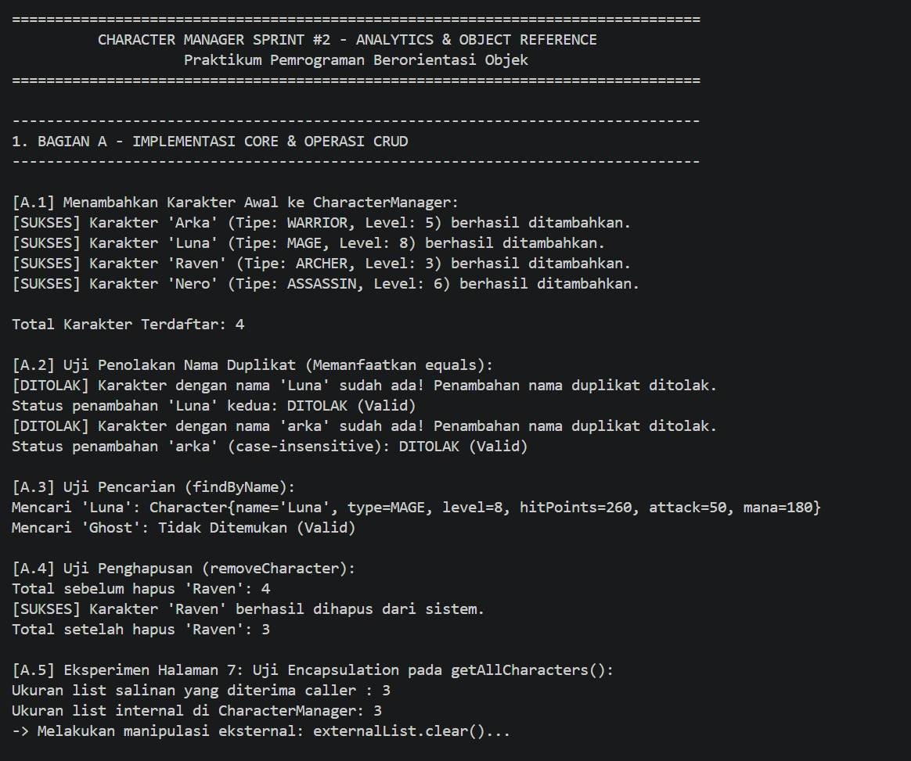
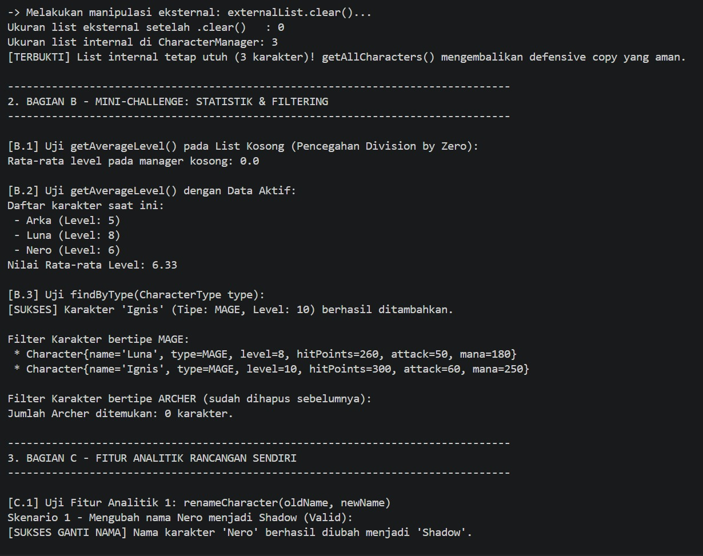
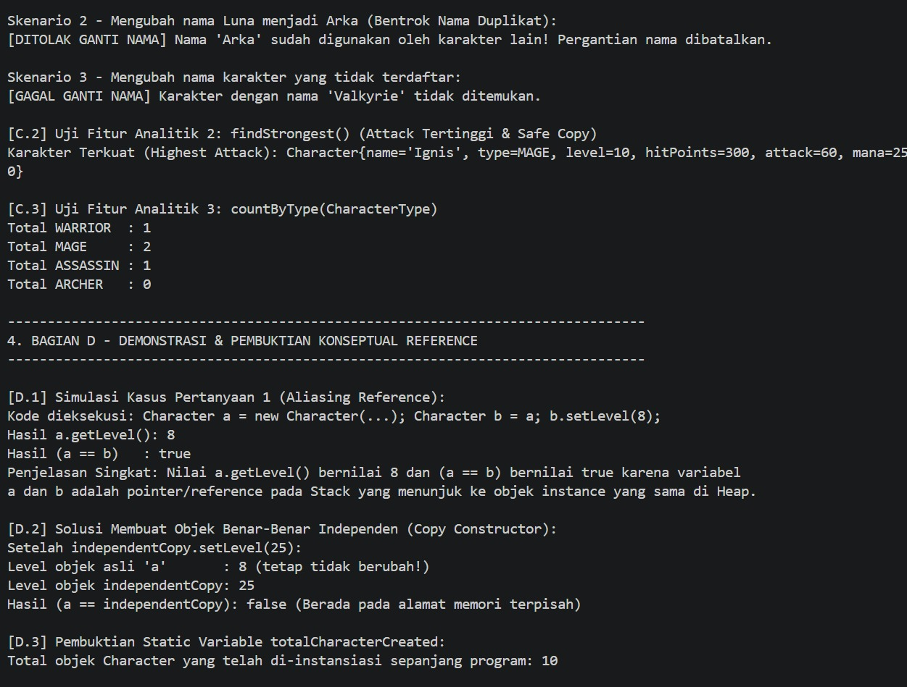
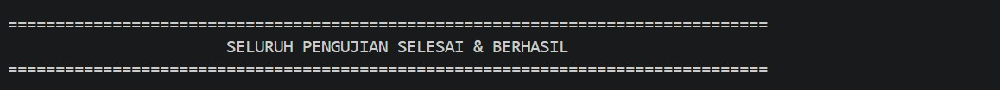
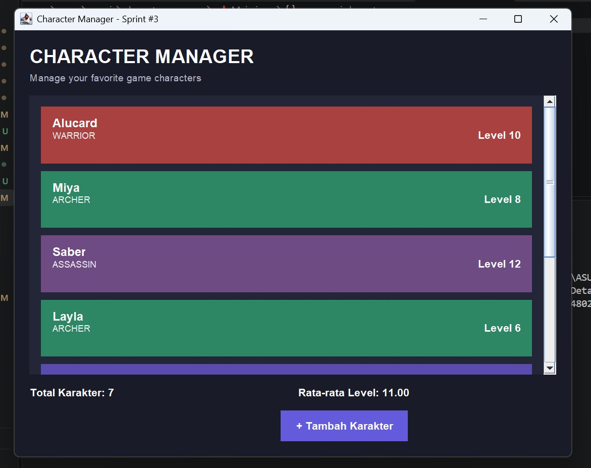
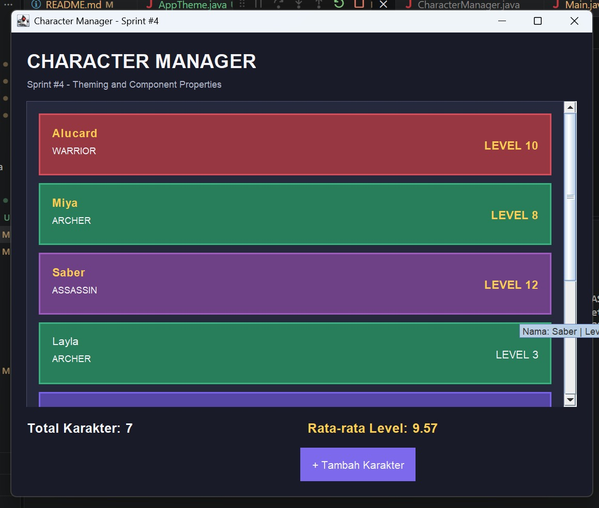

# ANALISIS OBJECT REFERENCE, STATIC, DAN ENCAPSULATION TP5

### IDENTITAS MAHASISWA
**Nama:** Keysi Permata Sari
**NIM:** 253303621228

---

## Object Reference dan Aliasing

Perhatikan kode berikut:

```java
Character a = new Character("KsatriaA", CharacterType.WARRIOR, 1);
Character b = a;
b.setLevel(8);
```

**Hasil:**
- `a.getLevel()` menghasilkan **8**.
- `a == b` menghasilkan **true**.

**Penjelasan:**

`b = a` menyalin reference, bukan membuat objek baru. Kedua variabel menunjuk objek yang sama di Heap. Kondisi ini disebut **Object Aliasing**.

Agar objek independen, gunakan copy constructor:

```java
Character b = new Character(a);
b.setLevel(8);
```

Dengan demikian, perubahan pada `b` tidak memengaruhi `a` dan `a == b` bernilai `false`.

---

## Primitive Value dan Reference Value

- **Primitive Value:** Assignment menyalin nilai secara langsung. Perubahan variabel salinan tidak memengaruhi variabel asal.
- **Reference Value:** Assignment menyalin nilai referensi sehingga dua variabel dapat menunjuk objek yang sama.

**Analogi:** Primitive seperti menyalin catatan ke kertas baru, sedangkan reference seperti dua kunci yang membuka loker yang sama.

---

## Penggunaan Static

Variabel `totalCharacterCreated` harus menggunakan `static` karena berfungsi menghitung seluruh objek `Character` yang dibuat.

```java
private static int totalCharacterCreated = 0;
```

Dengan `static`, semua objek menggunakan satu penghitung bersama. Jika tidak menggunakan `static`, setiap objek memiliki penghitung sendiri sehingga jumlah total karakter tidak dapat dihitung dengan benar.

---

## equals() dan hashCode()

Method bawaan `Object.equals()` membandingkan identitas reference, bukan isi objek. Akibatnya, dua objek berbeda dengan nama sama dianggap tidak sama.

Solusinya adalah melakukan override `equals()` dan `hashCode()`:

```java
@Override
public boolean equals(Object o) {
    if (this == o) return true;
    if (o == null || getClass() != o.getClass()) return false;

    Character character = (Character) o;
    return name != null && name.equalsIgnoreCase(character.name);
}

@Override
public int hashCode() {
    return name != null ? name.toLowerCase().hashCode() : 0;
}
```

Dengan implementasi tersebut, karakter dengan nama sama dianggap setara tanpa membedakan huruf besar dan kecil.

---

## Enkapsulasi dan Defensive Copying

Mengembalikan `ArrayList` asli dapat menyebabkan data internal `CharacterManager` diubah langsung oleh pihak luar.

Contohnya:
- Menambahkan karakter duplikat.
- Memasukkan nilai `null`.
- Menghapus seluruh data karakter.

Solusinya menggunakan **Defensive Copying**:

```java
public ArrayList<Character> getAllCharacters() {
    return new ArrayList<>(this.characters);
}
```

Dengan demikian, pemanggil mendapatkan list baru sehingga perubahan pada list tersebut tidak memengaruhi list internal `CharacterManager`.

## Screenshot Output CRUD





## Google Docs
Link Google Docs: "<https://docs.google.com/document/d/1rGlaiYQTcKmhFxSZHE_rc9npC0_kj8XpU547rbVT4JY/edit?usp=sharing>"

**Keysi Permata Sari | 253303621228**

# Character Manager – TP8 / AP10

## Deskripsi
Character Manager merupakan aplikasi berbasis Java Swing untuk mengelola data karakter game. Aplikasi ini menampilkan daftar karakter, tipe karakter, level, jumlah karakter, dan rata-rata level secara dinamis.

## Teknologi
- Java JDK 21
- Java Swing
- JFrame, JPanel, JLabel, JButton
- ArrayList
- Konsep Object-Oriented Programming (OOP)
- Model-View-Controller (MVC)

## Daftar Karakter

| Nama | Level | Tipe |
|---|---:|---|
| Alucard | 10 | WARRIOR |
| Miya | 8 | ARCHER |
| Saber | 12 | ASSASSIN |
| Layla | 6 | ARCHER |
| Gusion | 14 | MAGE |
| Fanny | 16 | ASSASSIN |
| Tigreal | 11 | WARRIOR |

Dua karakter tambahan:
1. Fanny – ASSASSIN, Level 16. Dipilih karena memiliki level tinggi dan menambah variasi karakter bertipe ASSASSIN.
2. Tigreal – WARRIOR, Level 11. Dipilih karena merupakan karakter bertipe WARRIOR dengan level menengah.

## Statistik
- Jumlah karakter awal: 7
- Total level: 77
- Rata-rata level: 11.00

Setelah tombol Tambah Karakter ditekan:
- Jumlah karakter: 8
- Total level: 86
- Rata-rata level: 10.75

## Alur Data dan MVC

Program dimulai dari Main.java yang membuat objek CharacterManager dan memasukkan data karakter ke dalamnya. Selanjutnya, Main.java memanggil MainWindow untuk menampilkan antarmuka menggunakan Java Swing. MainWindow mengambil data karakter dari CharacterManager melalui method getAllCharacters(), kemudian menampilkannya menggunakan perulangan. Ketika pengguna menekan tombol tambah karakter, data dikirim kembali ke CharacterManager dan tampilan diperbarui melalui refreshDisplay(). Proses ini menunjukkan pemisahan antara Model yang mengelola data, View yang menampilkan antarmuka, dan Controller yang mengatur alur interaksi aplikasi.

## Fitur
1. Menampilkan daftar karakter secara dinamis.
2. Menampilkan level dan tipe setiap karakter.
3. Menghitung jumlah karakter.
4. Menghitung rata-rata level karakter.
5. Menambahkan karakter baru melalui tombol.
6. Memperbarui statistik secara otomatis.
7. Memberikan warna berbeda berdasarkan tipe karakter.

## Screenshot


## Google Docs – Bagian D
Link analisis GUI dan MVC:
[https://docs.google.com/document/d/1_GtfvAoyNY858vT93FwIZh9hws2aPYaj6LWQ9VVL6CI/edit?usp=sharing]


# TP10 – Character Manager Sprint #4

## A. Implementasi AppTheme

Pada Sprint #4, aplikasi Character Manager menggunakan class AppTheme sebagai pusat pengaturan tampilan. AppTheme menyimpan warna, font, dan border yang digunakan oleh MainWindow.

Fitur tema:
- Background aplikasi menggunakan warna gelap.
- Setiap role memiliki warna kartu berbeda.
- Karakter dengan level minimal 5 mendapatkan teks emas dan tebal.
- Font menggunakan logical font SansSerif.
- Border kartu menyesuaikan role karakter.

## B. Mini-Challenge dan Properti Tambahan

Batas level tinggi disimpan dalam konstanta HIGH_LEVEL_THRESHOLD dengan nilai 5.

Karakter dengan level >= 5 ditampilkan menggunakan warna emas dan font tebal.

Dua properti tambahan yang diterapkan:

1. **Tooltip:** Menampilkan informasi nama, level, dan role karakter ketika pointer mouse diarahkan ke kartu. Properti ini membantu pengguna mengetahui informasi karakter tanpa memenuhi tampilan utama.
2. **Border berdasarkan role:** Setiap kartu memiliki border dengan warna yang mengikuti role karakter. Hal ini mempermudah pengguna membedakan karakter secara visual.

## C. Data Karakter

| Nama | Level | Role |
|---|---:|---|
| Alucard | 10 | WARRIOR |
| Miya | 8 | ARCHER |
| Saber | 12 | ASSASSIN |
| Layla | 3 | ARCHER |
| Gusion | 14 | MAGE |
| Fanny | 16 | ASSASSIN |
| Tigreal | 4 | WARRIOR |

Total karakter: 7

Total level: 67

Rata-rata level: 9.57

## D. Mengapa Warna Disimpan di AppTheme?

Warna disimpan di AppTheme karena pengaturan tampilan merupakan tanggung jawab View. Character sebagai Model hanya menyimpan informasi karakter seperti nama, level, dan role. Dengan memisahkan tema dari Model, perubahan tampilan dapat dilakukan tanpa mengubah struktur data karakter.

Pemisahan tersebut juga membuat program lebih mudah dikembangkan dan dipelihara. Jika warna role ingin diubah, programmer cukup mengubah AppTheme tanpa mengubah Character.java atau CharacterManager.java.

## E. Screenshot

### Sebelum (Sprint #3 / v0.3)


### Sesudah (Sprint #4 / v0.4)


## F. Analisis Google Docs

Link Google Docs Bagian D:
[https://docs.google.com/document/d/12tHNQeVO46vodmkLwqnWLq-aCcTH9I9hE5iqt1VPI5Y/edit?usp=sharing]

## G. Teknologi
- Java JDK 21
- Java Swing
- JFrame
- JPanel
- JLabel
- JButton
- ArrayList
- AppTheme
- Model-View-Controller (MVC)


# Java Visual - Character Manager

## TP12 - AP16 Belajar Praktik
### Character Manager Sprint #5
**Layout, UI Responsif & Analisis MVC**

---

## Identitas Mahasiswa

- **Nama:** Keysi Permata Sari
- **NIM:** 253303621228
- **Mata Kuliah:** Java Visual (SIH-6406)
- **Tugas:** TP12 - AP16
- **Sprint:** #5
- **Tanggal:** 5 November 2026

---

## Deskripsi Project

Character Manager merupakan aplikasi desktop berbasis Java Swing
yang digunakan untuk menampilkan dan mengelola data karakter.

Pada TP12, aplikasi dikembangkan dengan menerapkan Layout Manager
agar tampilan tetap rapi dan responsif ketika ukuran jendela
diperbesar maupun diperkecil.

Pengembangan ini berfokus pada penggunaan BorderLayout,
JScrollPane, BoxLayout, GridLayout, serta penerapan prinsip MVC
(Model-View-Controller).

---

## Teknologi yang Digunakan

- Java JDK 21
- Java Swing
- IntelliJ IDEA / Visual Studio Code
- Git dan GitHub
- Layout Manager
- Model-View-Controller (MVC)

---

# TP12 - Implementasi Layout

## A. Implementasi BorderLayout

MainWindow v0.5 menggunakan BorderLayout dengan empat wilayah:

| Wilayah | Komponen | Fungsi |
|---|---|---|
| NORTH | Header dan statistik | Menampilkan judul dan informasi karakter |
| CENTER | JScrollPane | Menampilkan daftar kartu karakter |
| EAST | Panel legenda | Menampilkan jenis role karakter |
| SOUTH | Status bar | Menampilkan jumlah karakter dan versi aplikasi |

BorderLayout membantu membagi tampilan aplikasi menjadi beberapa
wilayah sehingga setiap komponen memiliki posisi yang jelas.

## B. Implementasi JScrollPane

Daftar karakter ditampilkan menggunakan JScrollPane agar pengguna
dapat menggulir daftar ketika jumlah karakter bertambah atau ukuran
jendela diperkecil.

Kartu karakter dimasukkan ke dalam cardsPanel, kemudian panel
tersebut dimasukkan ke panel pembungkus yang menjadi isi JScrollPane.

Preferred size digunakan agar ukuran awal area daftar karakter
dapat ditentukan dengan baik.

## C. Implementasi BoxLayout

Panel legenda menggunakan BoxLayout dengan arah Y_AXIS.

Legenda dibuat secara otomatis menggunakan:

```java
for (CharacterType type : CharacterType.values()) {
    JLabel role = new JLabel(type.toString());
    legendPanel.add(role);
}
```

Dengan cara ini, setiap jenis karakter yang terdapat pada enum
CharacterType dapat ditampilkan tanpa menulis JLabel satu per satu.

VerticalStrut digunakan untuk memberikan jarak antarrole,
sedangkan VerticalGlue digunakan untuk mengisi ruang kosong.

## D. Panel Statistik Tambahan

Panel statistik menggunakan GridLayout 2x2.

Panel ini menampilkan empat informasi:

1. Total Characters
2. Average Level
3. Highest Level
4. Role Types

GridLayout dipilih karena setiap informasi memiliki ukuran sel
yang sama sehingga tampilannya lebih teratur.

FlowLayout tidak dipilih karena susunan statistik akan lebih sulit
dipertahankan dalam bentuk empat informasi yang sejajar.

---

## E. Screenshot Aplikasi

Tambahkan tiga screenshot hasil pengujian aplikasi pada bagian ini.

### 1. Screenshot Ukuran Awal

Menampilkan tampilan aplikasi ketika pertama kali dijalankan.

)

### 2. Screenshot Jendela Diperlebar

Menampilkan perubahan ukuran kartu dan area aplikasi ketika
jendela diperlebar.

)

### 3. Screenshot Jendela Diperkecil

Menampilkan tampilan aplikasi ketika ukuran jendela diperkecil
hingga scrollbar terlihat.

)

---

## F. Tabel Pengamatan Resize

| Kondisi | Prediksi | Hasil Pengamatan |
|---|---|---|
| Ukuran awal | Semua panel terlihat dengan rapi | Isi sesuai hasil pengujian |
| Jendela diperlebar | Area daftar karakter mendapatkan ruang lebih besar | Isi sesuai hasil pengujian |
| Jendela diperkecil | Area daftar menjadi lebih sempit dan scrollbar muncul | Isi sesuai hasil pengujian |screen

Catatan: Hasil pengamatan akhir disesuaikan dengan screenshot
pengujian aplikasi.

---

## G. Analisis Struktur Panel

Aplikasi menggunakan BorderLayout sebagai layout utama pada
jendela. Bagian NORTH berisi panel header dan statistik yang
disusun menggunakan BorderLayout dan GridLayout. Bagian CENTER
berisi JScrollPane yang menampung panel kartu karakter, sedangkan
bagian EAST berisi legenda dengan BoxLayout Y_AXIS. Bagian SOUTH
digunakan sebagai status bar dengan BorderLayout agar informasi
status berada di kiri dan versi aplikasi berada di kanan.

## H. Alasan Pemilihan Layout

GridLayout dipilih untuk panel statistik karena empat informasi
ditampilkan dengan ukuran yang sama dalam dua baris dan dua kolom.

BoxLayout dipilih untuk legenda karena jenis role disusun secara
vertikal. BorderLayout dipilih sebagai layout utama karena
membantu membagi jendela menjadi beberapa wilayah.

FlowLayout tidak dipilih untuk panel statistik karena posisi
komponen dapat berpindah baris mengikuti ruang yang tersedia,
sehingga kurang sesuai dengan susunan statistik 2x2 yang
diinginkan.

---

## I. Konsep MVC

Aplikasi menerapkan konsep Model-View-Controller (MVC).

- Model: Menyimpan data karakter dan jenis karakter.
- View: Menampilkan data melalui MainWindow menggunakan Java Swing.
- Controller: Mengatur interaksi dan menghubungkan model dengan view.

Pemisahan package model dan view membuat program lebih mudah
dikembangkan dan dipelihara.

Kode layout ditempatkan di package view karena layout merupakan
bagian dari tampilan aplikasi, bukan bagian dari penyimpanan data.

---

## J. Pemeriksaan Model

File pada package model tidak diubah dalam TP12.

File yang dipertahankan:

- Character.java
- CharacterManager.java
- CharacterType.java

Pemeriksaan perubahan dapat dilakukan menggunakan perintah:

```bash
git diff -- src/com/unpri/charactermanager/model/
```

Jika tidak terdapat perubahan, berarti file model tidak mengalami
modifikasi pada pengerjaan TP12.

---

## K. Cara Menjalankan Program

Pastikan Java JDK sudah terpasang.

Compile seluruh file Java:

```powershell
$files = Get-ChildItem .\src -Recurse -Filter *.java |
ForEach-Object { $_.FullName }

javac -encoding UTF-8 -d .\out $files
```

Jalankan aplikasi:

```bash
java -cp out com.unpri.charactermanager.Main
```

---

## L. Git Commit

Riwayat commit TP12 menggunakan format Conventional Commits.

Contoh pembagian commit:

1. `feat(view): implement BorderLayout regions`
2. `feat(view): add scrollable character cards`
3. `feat(view): implement dynamic role legend`
4. `feat(app): add statistics and version status bar`
5. `docs(tp12): add README and resize documentation`

---

## M. Google Docs - Analisis Layout dan MVC

Dokumen analisis Bagian D:

**Link Google Docs:**
[https://docs.google.com/document/d/19rzLr87ox35yjBMp-VVWw2gW8PY56QVFBe-U-1WtBHI/edit?usp=sharing]

Nama dokumen:

JavaVisual_TP12_253303621228_KeysiPermataSari

Dokumen berisi analisis minimal 500 kata mengenai:

1. Permasalahan setLayout(null) dan penggunaan Layout Manager.
2. Default layout JPanel dan JFrame.
3. Perilaku lima wilayah BorderLayout.
4. Perbandingan GridLayout dan BoxLayout.
5. Pemisahan Model dan View serta fungsi revalidate() dan repaint().

---

## N. Kesimpulan

Melalui pengerjaan TP12, aplikasi Character Manager mengalami
pengembangan pada bagian tampilan dengan menggunakan berbagai
Layout Manager pada Java Swing.

Penggunaan BorderLayout, JScrollPane, BoxLayout, dan GridLayout
membantu menghasilkan tampilan yang lebih terstruktur dan
responsif.

Selain implementasi program, tugas ini juga memberikan
pemahaman mengenai konsep MVC, pemisahan tanggung jawab antara
Model dan View, serta pentingnya Layout Manager dalam
pengembangan aplikasi desktop.